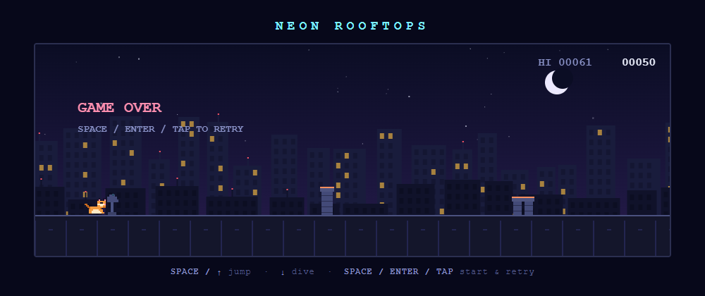
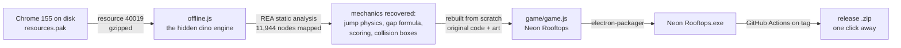
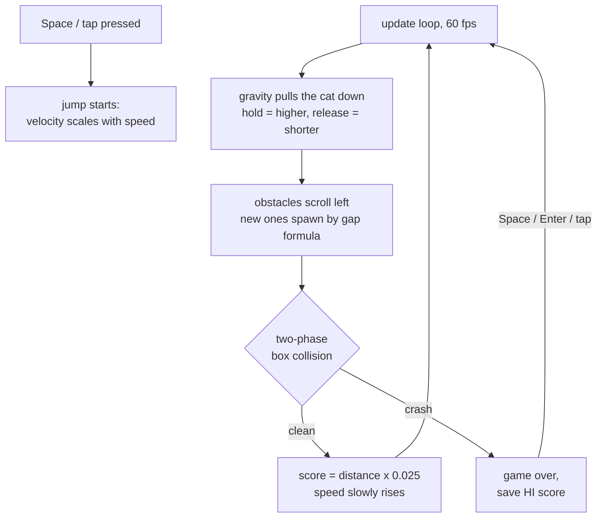

<div align="center">

# 🐱🌙 Neon Rooftops

**An original pixel-art endless runner. A little cat sprints across neon rooftops at night, hopping chimneys, dishes, AC units and drones.**

Play it in the browser, or grab the standalone Windows app. No install, no browser needed.




</div>

> 🦖 **Born from reverse engineering.** We reverse engineered the original Chrome dinosaur game, pulled straight out of Chrome's own `resources.pak` on disk with [REA](https://github.com/morluto/rea), a reverse engineering toolkit, studied exactly how it ticks, then rebuilt it from scratch as this game with 100% original code and pixel art. Same soul, new cat. No Chromium assets are used or shipped here.

## 📥 Download & play

1. Go to the [latest release](../../releases/latest)
2. Grab `NeonRooftops-x.y.z-win-x64.zip`
3. Unzip, double-click **Neon Rooftops.exe**

That's it. The app bundles its own engine, so nothing gets installed and no browser window opens. The exe is unsigned, so Windows may show "More info → Run anyway" once. To play in a browser instead, just open `game/index.html`.

## 🎮 Controls

| Key | What it does |
| --- | --- |
| <kbd>Space</kbd> / <kbd>↑</kbd> | Start, jump. Hold for a higher jump, release early for a short hop |
| <kbd>↓</kbd> | Dive while airborne |
| <kbd>Space</kbd> / <kbd>Enter</kbd> / tap | Restart after a crash |

## ✨ Features

- 🏃 Endless auto-run with a score counter and saved personal best (`HI`)
- 📈 Difficulty ramps up: speed climbs from 6 to 13, gaps widen as you go faster
- 🧱 Five hurdle types: chimney stacks (1 to 3 in a cluster), satellite dishes, wide AC units, and speed-gated drones
- 🐈 Fair collisions: two-phase hitboxes, so grazing pixels won't kill you
- 🌃 Living night city: parallax skylines, twinkling stars, blinking antennas
- 🎉 Milestone confetti burst every 100 points
- 🌈 The night sky evolves as you run: indigo, magenta dusk, teal dawn
- 🏆 Local leaderboard (real SQLite) with a game-over name prompt
- 💥 Crash juice: screen shake, particles, squash and stretch
- 🪶 Zero dependencies in the game itself, one HTML file + one JS file

## 🔬 How it was made

The Chrome dino game ships compressed inside Chrome's `resources.pak`. We extracted it, mapped the whole engine statically with [REA](https://github.com/morluto/rea) (11,944 code nodes), and pulled out every formula and constant. Then we re-implemented them with original art.



## 🔄 How the game works



## 🛠️ Development

```bash
# run the 9-group self-test (physics, gaps, collision, spawns, restart)
node game/game.js

# desktop app: dev mode and Windows build
cd desktop
npm install
npm start        # dev
npm run build    # -> dist/Neon Rooftops-win32-x64/Neon Rooftops.exe
```

Pushing a `v*` tag makes GitHub Actions build and publish a release automatically.

## 📄 License

[MIT](LICENSE). Original code and art. Not affiliated with Google or the Chrome team. We just took their dino apart to learn from it, then let the cat out.
